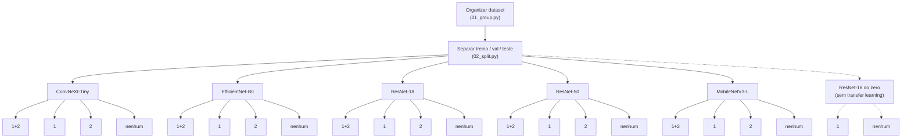

# Fluxo dos experimentos

**Casos:** `1` = data augmentation · `2` = freeze (só a última camada treina) · `nenhum` = fine-tuning completo sem augmentation



## Versão em texto

```
                         ┌──────────────────┐
                         │ Organizar dataset│  01_group.py
                         └────────┬─────────┘
                                  ▼
                       ┌────────────────────┐
                       │ Separar T / V / T  │  02_split.py
                       └─────────┬──────────┘
   ┌──────────────┬──────────────┼──────────────┬──────────────┬ ─ ─ ─ ─ ─ ─ ─ ─┐
   ▼              ▼              ▼              ▼              ▼                ▼
ConvNeXt-Tiny  EfficientNet-B0  ResNet-18     ResNet-50    MobileNetV3-L   ResNet-18 do zero
                                                                         (sem transfer learning)
1+2 1 2 —      1+2 1 2 —      1+2 1 2 —      1+2 1 2 —      1+2 1 2 —          1  —
```

## Experimentos por script (um por pessoa)

| Script | Rede | Casos | Nº de treinos |
|---|---|---|---|
| `03_train_convnext_tiny.py` | ConvNeXt-Tiny (ImageNet) | 1+2, 1, 2, nenhum | 4 |
| `03_train_efficientnet_b0.py` | EfficientNet-B0 (ImageNet) | 1+2, 1, 2, nenhum | 4 |
| `03_train_resnet18.py` | ResNet-18 (ImageNet) | 1+2, 1, 2, nenhum | 4 |
| `03_train_resnet50.py` | ResNet-50 (ImageNet) | 1+2, 1, 2, nenhum | 4 |
| `03_train_mobilenet_v3_large.py` | MobileNetV3-Large (ImageNet) | 1+2, 1, 2, nenhum | 4 |
| `03_train_scratch.py` | ResNet-18 (pesos aleatórios) | 1, nenhum | 2 |
| **Total** | | | **22** |
